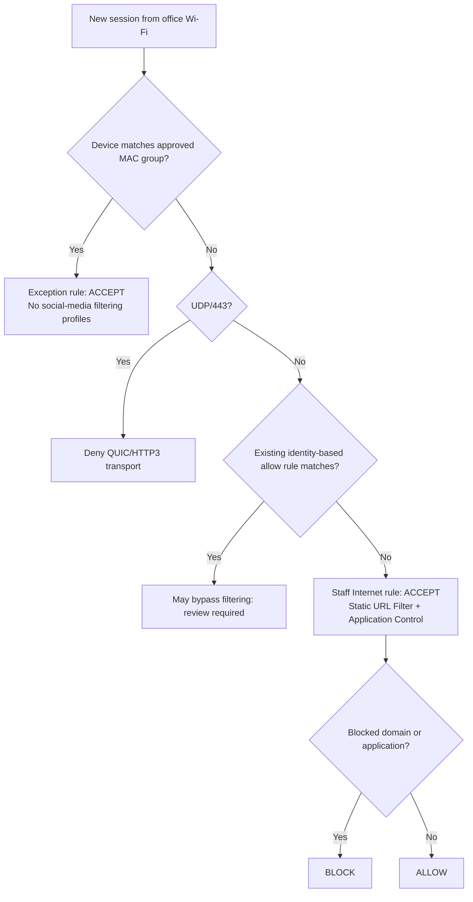

# FortiGate — MAC-based exceptions and web/application filtering

A firewall administration case study: controlling recreational web traffic on an office Wi-Fi network without restricting a small group of approved devices.

This write-up focuses on **what changed, why it changed, and how the result was checked**. It is not a copy of a production firewall configuration.

**Stack:** Fortinet FortiGate · FortiOS 7.x · UniFi wireless access points · Firewall Policies · Static URL Filter · Application Control

## The problem

The requirement was to restrict social media, video streaming, adult content, gaming, and other non-work sites for staff using the office Wi-Fi. A small set of explicitly approved devices needed unrestricted access.

Two constraints shaped the implementation:

1. **FortiGuard web categorization was unavailable** in the environment. Using the built-in category labels alone would not provide the expected protection.
2. Filtering had to **exclude selected devices without changing unrelated server, VPN, or WAN rules**.

The approach was to use a static domain list for web filtering, an application signature category for additional coverage, and a MAC-based exception rule placed before the restricted-user rules.

## What was implemented

| Control | Implementation | Reason |
| --- | --- | --- |
| Approved devices | MAC address objects grouped into an allowlist | Clear exception for specific endpoints |
| Web filtering | Static URL filter containing **49 entries** | FortiGuard category service unavailable |
| Application filtering | Application Control profile with a social-media category block | Supplement domain-based filtering |
| QUIC handling | UDP/443 deny for non-exempt clients | Encourage compatible clients to fall back to inspectable TCP/443 |
| Firewall policy | Separate allowlist, QUIC-deny and restricted-internet rules | First-match policy evaluation keeps exceptions above restrictions |
| HTTPS inspection | Certificate inspection | Domain/SNI visibility without deploying a local CA to endpoints |

### Policy flow

**Important:** a device that is absent from the MAC allowlist is not automatically blocked from the Internet. It continues through the remaining policies. Filtering occurs only if the session reaches the policy with the inspection profiles.

## Configuration decisions

### 1. Static URL filtering instead of FortiGuard categories

The initial licensing/status check showed that the web-rating service was disabled. I therefore created a **separate** URL filter table and attached it through a dedicated Web Filter profile rather than modifying existing filters.

The table contained **49 entries** across five content groups:

| Group | Entries |
| --- | ---: |
| Social platforms | 10 |
| Video platforms | 5 |
| Adult sites | 15 |
| Gaming platforms | 15 |
| Entertainment / time-wasting sites | 4 |
| **Total** | **49** |

The list is deliberately not reproduced here. Exact domains and wildcard syntax should be reviewed for false positives and incomplete coverage. A static list never replaces a maintained category reputation service.

### 2. Application Control as a second layer

A separate Application Control profile was attached to the restricted-user policy. Its intended social-media category rule was set to **block and log**, while unrelated and unknown application actions remained set to pass.

**Category confirmed:** The device profile specifies `category 23`, `action block` and `log enable`. Fortinet's FortiOS 7.0 documentation identifies category **23 as Social.Media**. Other and unknown applications are set to pass. This verifies the configuration, not classification of every individual app.

### 3. QUIC policy below the exception

Web filtering of modern web applications can be affected by QUIC / HTTP/3 on UDP port 443. A dedicated deny rule was added **below the approved-device exception** so the exception could still pass that traffic, while non-exempt devices would often fall back to HTTPS over TCP.

This decision trades some application performance/compatibility for more consistent inspection opportunities. Denying UDP/443 alone does not block social media.

### 4. Validate the exception using session policy IDs

After applying the exception, new sessions from a test endpoint were checked in the FortiGate session table. The session was observed hitting the **exception policy**. This is stronger evidence than relying only on the position or name of the rule.

The notes also record clearing the **test device's existing sessions** when the inspection profile was attached, so the test would use the new policy path.

## Implementation sequence

1. Reviewed system status, interfaces, firewall policies, web-filter configuration, DHCP and licensing.
2. Determined that FortiGuard category filtering was unavailable and selected static URL filtering.
3. Created a new static URL table and a separate Web Filter profile without touching the older profiles.
4. Created a test MAC object, allowlist group, and higher-priority exception policy.
5. Checked live session information to verify that the test device matched the exception rule.
6. Attached the static URL Web Filter profile to the general staff Internet rule.
7. Added the Application Control profile and a separate UDP/443 deny policy.
8. Expanded the static list to its final 49-entry set.
9. Documented scope, residual risks, and rollback.

## Results observed in production

The administrator confirmed the intended access behavior after deployment:

- **Approved MAC group:** devices registered in the exception group can access social-media services.
- **Other devices on the protected office network:** social-media access is blocked.
- **Policy matching:** a tested approved device was independently observed selecting the exception policy in the FortiGate session table.

This is an **operator-confirmed functional result**, not a formal audit of every application, device type or possible bypass. No raw endpoint identifiers or session logs are published.

## What the evidence supports

| Claim | Evidence |
| --- | --- |
| Approved test device matched the exception rule | Session table showed the exception policy ID |
| Staff Internet policy had the Web Filter and Application Control attached | Firewall policy configuration |
| Static URL table contained 49 entries | Configuration notes |
| Approved devices can access social media; other devices are blocked on the protected network | **Confirmed by administrator through functional testing** |
| Older identity-based accept rules cannot bypass filtering | **Not fully evidenced** |
| Alternative wireless interfaces are covered | **Requires separate verification** |

### Compiled policy verification

A read-only `diagnose firewall iprope list 100004` check confirmed that the MAC exception rule is installed with six MAC match entries, the QUIC rule is a UDP/443 drop, and the staff Internet rule is installed. This shows compiled policy logic, not live per-user policy hits.

## Limitations worth keeping visible

- HTTPS **certificate inspection** does not reveal full encrypted URLs or content; domain/SNI-based decisions have limits.
- A fixed domain list misses newly created or unlisted domains. Some shared infrastructure domains may cause collateral blocking.
- MAC addresses are not strong identities. Private/randomized Wi-Fi MAC behavior can change allowlist matching.
- External VPNs, mobile data and other alternative paths can bypass this particular firewall path.
- Earlier identity-based ACCEPT policies without inspection profiles may bypass filtering if they match.
- Blocking UDP/443 can reduce performance or break HTTP/3-only behavior in some apps.
