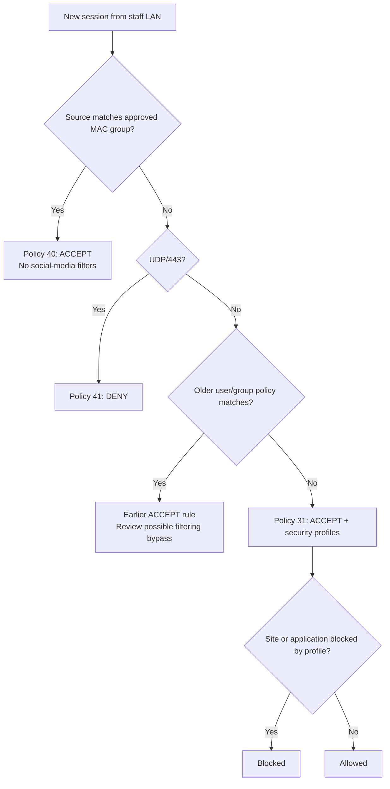

# FortiGate: social media filtering with MAC-based exceptions

A firewall configuration case study from a small office environment. The requirement was straightforward: restrict social media for regular staff while keeping access available for a handful of approved devices. The difficult part was making the exception reliable without creating a rule that accidentally bypassed filtering for everyone else.

**Platform:** FortiGate 50G · FortiOS 7.0.17  
**Management:** FortiGate GUI and CLI  
**Focus:** Policy order, MAC address objects, Web Filter, Application Control, QUIC

> This is a sanitized write-up, not a deployable backup of a company firewall. Real addresses, device identifiers, user data and credentials are intentionally omitted.

## The requirement

The office needed two different internet access behaviors:

- **Approved devices:** normal internet access, including social media, without the social-media Web Filter or Application Control restrictions.
- **Other staff devices:** normal work-related browsing, but social-media sites and apps should be subject to the blocking profiles.

The restriction was intended for both laptops/desktops and mobile devices. Whether a particular device is actually covered depends on which firewall interface its traffic enters.

## What I configured

The work used a **MAC address group** for the approved endpoints and separate policies for the exception, QUIC traffic, and the remaining staff internet access.

The following is the policy logic observed in the configuration. Names are intentionally simplified; the IDs are included to make the troubleshooting narrative easier to follow.

| Policy ID | Purpose | Matching condition | Result |
| --- | --- | --- | --- |
| **40** | Approved-device exception | Source MAC in approved group | Allow; no social-media inspection profiles |
| **41** | QUIC restriction | Remaining traffic using UDP/443 | Deny |
| **13 / 14** | Older user/group rules | Matching authenticated identity | Allow without these profiles; potential bypass |
| **31** | Default staff internet rule | Staff LAN traffic not matched above | Allow with Web Filter + Application Control |

The critical detail is **rule order**, not the numeric policy ID. FortiGate evaluates policies from top to bottom and selects the first match for a new session.

### Why policy 40 is above the filtering policy

An approved device should match policy 40 *before* it gets to the QUIC deny and social-media filtering rules. That rule has an ACCEPT action and intentionally has no social-media Web Filter or Application Control profile. The absence of these profiles is part of the exception design.

An unlisted device does **not** get blocked simply because its MAC address is missing. It fails to match policy 40 and is evaluated against the next policies.

## Why I added the UDP/443 rule

Modern browsers and apps may use **QUIC / HTTP/3** over UDP port 443 rather than HTTPS over TCP port 443.

For clients that are *not* on the exception list, the UDP/443 deny rule can force compatible clients to try TCP/443 instead. The Web Filter and Application Control on the later staff policy can then evaluate the resulting traffic according to their configured capabilities.

This is **not** a universal social-media block. UDP/443 denial affects more than social media, and some applications may not fall back cleanly. The actual filtering decision still depends on application signatures, categorization, inspection settings and which firewall policy matches.

## Troubleshooting notes

### 1. A rule named “Block” does not necessarily block social media

Two older, identity-based ACCEPT rules appear before the filtered staff internet policy. Neither has the social-media filtering profiles attached. If a connection matches one of these rules, it will not reach policy 31.

**Follow-up:** Review their intended purpose, identify actual hits and remove any unintended bypass through an approved change. I have not marked this as resolved.

### 2. Wired LAN and wireless traffic may take different paths

The documented exception and filtering policies apply to one LAN-to-WAN path. A separate wireless-to-internet policy exists without these profiles. Mobile device coverage therefore needs its own route/interface verification and, if appropriate, equivalent controls.

**Follow-up:** Verify ingress interface, NAT behavior and MAC visibility on wireless clients before asserting that every phone is filtered.

### 3. MAC matching is convenient, but not strong authentication

A laptop's Ethernet and Wi-Fi adapters have different MAC addresses. Phones may use private/randomized MAC addresses. MACs can also be spoofed.

**Follow-up:** Confirm policy hits with a test device and consider authenticated device/user controls for stronger assurance.

## What has been checked

| Item | Evidence / current status |
| --- | --- |
| Exception policy (40), QUIC deny (41), filtered staff policy (31) | Present in the supplied FortiGate CLI output |
| Approved-device access | Reported working during administration; traffic-log evidence not yet added |
| Full social-media blocking for other staff | Not yet independently documented |
| Older identity-rule bypass | Identified for review |
| Phone / separate Wi-Fi path coverage | Still requires testing |

I prefer to record **“not verified”** rather than claim complete enforcement without logs or repeatable endpoint tests.

## Repository contents

- [Policy configuration breakdown](docs/policy-design.md) — how each rule affects traffic
- [Validation checklist](docs/validation-checklist.md) — repeatable tests for approved and ordinary endpoints
- [Policy logic example](examples/policy-logic.txt) — non-executable, sanitized illustration
- [Security and publishing notes](SECURITY.md) — what should never be published from a production firewall

## Next improvements

- Capture redacted policy-hit results from a test session.
- Verify browser **and native app** behavior on one approved and one non-approved device.
- Review legacy user/group rules for filtering bypass.
- Confirm separate Wi-Fi policy coverage and private MAC behavior.

---

*Portfolio case study. Any screenshots and evidence added later will be redacted and published only with the organization's permission.*
