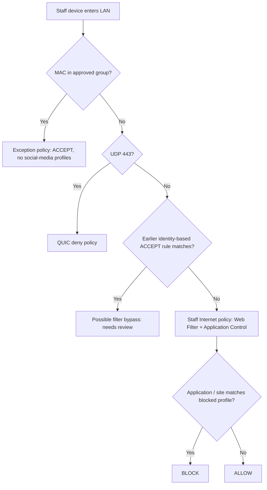

# FortiGate Social Media Access Control
### MAC-Based Exceptions · Web Filtering · Application Control · QUIC

A sanitized, real-world network-security case study documenting how a FortiGate firewall can exempt approved staff devices from social-media restrictions while filtering other endpoints.

> **Portfolio documentation, not a live configuration backup.** No actual device MACs, production IPs, credentials, organization identifiers, serial numbers, or secrets are published. Reuse only in an authorized environment after testing.

## Goal
- Permit approved devices to bypass social-media filtering.
- Apply Web Filter and Application Control to other staff traffic.
- Handle QUIC / HTTP/3 (UDP 443) when relevant to inspection.
- Preserve unrelated server, VPN, and business traffic.

## Environment
| Component | Technology |
|---|---|
| Firewall | Fortinet FortiGate 50G |
| OS | FortiOS 7.0.17 |
| Management | FortiGate Web GUI / CLI |
| Controls | Firewall policies, MAC address groups, Web Filter, Application Control |

## Traffic flow

## Illustrative policy order

| Priority | Case-study policy ID | Function | Source | Action | Security profiles |
|---|---|---|---|---|---|
| 1 | 40 | Staff MAC exception | Approved MAC group | ACCEPT | Social-media Web Filter/App Control OFF |
| 2 | 41 | QUIC restriction | Other LAN clients | DENY UDP/443 | N/A |
| 3 | 13 / 14 | Legacy identity policies | User / group based | ACCEPT | No social-media profiles; needs review |
| 4 | 31 | General staff Internet | Staff subnet | ACCEPT | Social-media Web Filter + Application Control |

**First matching policy wins.** Unlisted MACs are not automatically denied; they are evaluated against subsequent policies. An earlier broad ACCEPT rule without profiles can bypass filtering.

## Why QUIC matters
QUIC / HTTP/3 commonly uses UDP port 443. Blocking UDP/443 can cause compatible browsers to fall back to TCP/443, where the existing filtering policy may inspect HTTPS traffic. QUIC blocking alone does **not** block social-media services.

## Limitations and safeguards
- Wireless clients on another incoming interface need separate policies and tests.
- Endpoint MAC visibility is necessary; intermediate NAT and private/random Wi-Fi MACs can change behavior.
- MAC addresses can be spoofed. A MAC allowlist is **not strong authentication**.
- SSL inspection, signatures, policy order, licensing, alternative networks and client behavior affect results.
- Existing VPN and identity-based policies must be reviewed before changes.
- This repository does not claim that every app or endpoint has been tested successfully.

## Documentation
- [Detailed policy design](docs/policy-design.md)
- [Validation checklist](docs/validation-checklist.md)
- [Illustrative, non-executable policy logic](examples/policy-logic.txt)
- [Confidentiality and publication guidance](SECURITY.md)

## Current validation status
| Observation | Status |
|---|---|
| Exception, QUIC deny and filtered staff rules | Observed in CLI |
| Approved device Internet access | Reported working by administrator; log evidence pending |
| Other staff blocked on all social-media services | Not independently verified |
| Legacy user/group policy bypass | Needs review |
| Separate UniFi/Wi-Fi coverage | Needs review |

## Technologies and skills
FortiGate · FortiOS · Firewall Policy Ordering · Network Segmentation · Web Filtering · Application Control · QUIC/HTTP3 · Troubleshooting · Security Documentation
